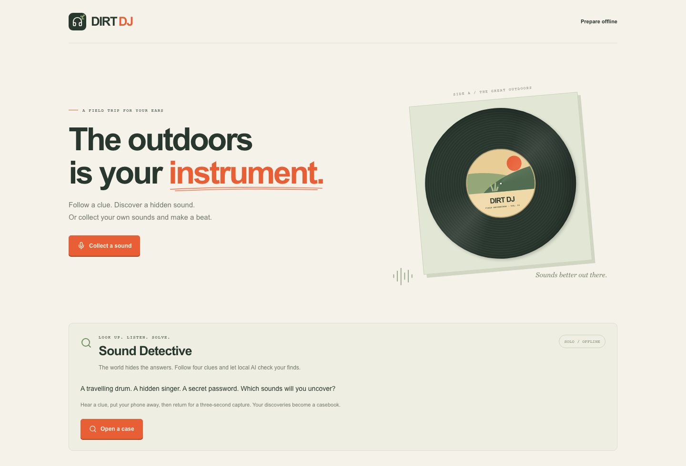

# Dirt DJ

**The outdoors is your instrument.** A solo sound hunt and beat maker for Android and the web, powered by AI that runs on your device.

[Try the app](https://dirtdj.onrender.com) · [Android guide](docs/MOBILE.md)



## What you can do

- **Sound Detective:** Follow four clues, put your phone away, and return for a three-second capture. Local AI checks what you found.
- **Sound Postcard:** Save your four discoveries as a short WAV.
- **Dirt Deck:** Arrange recordings across four sound lanes. Edit steps, tempo, and levels while the beat keeps playing, then export it.

## Run locally

Requires **Node.js 24**.

```bash
npm ci
npm run setup
npm run build
npm run preview
```

Open **http://localhost:4173**. For development, run `npm run dev`.

## Offline

**Web:** Prepare the offline pack once while connected, then reopen without internet. The model and runtime download is about 105 MB.

**Android:** The APK bundles the AI assets and works offline after installation. See the [build and installation guide](docs/MOBILE.md).

Recordings stay on your device. No account, backend, database server, or inference API key is required.

## Built with

React, TypeScript, Vite, Capacitor, Web Audio, and IndexedDB. [AST](https://huggingface.co/MIT/ast-finetuned-audioset-10-10-0.4593) runs locally through [Xenova's quantized ONNX model](https://huggingface.co/Xenova/ast-finetuned-audioset-10-10-0.4593), Transformers.js, and ONNX Runtime Web.

AI recognizes sound; the audio engine creates the beat. Read the [project explainer](docs/EXPLAINER.md) for details.

## Checks

```bash
npm test
npx playwright install chromium
npm run test:e2e
```

[GitHub Actions](https://github.com/ItsVats/DirtDJ/actions/workflows/ci.yml) tests offline inference and builds Android test APKs.

## License

[MIT](LICENSE). See [third-party notices](THIRD_PARTY_NOTICES.md) for model and dependency licenses.
