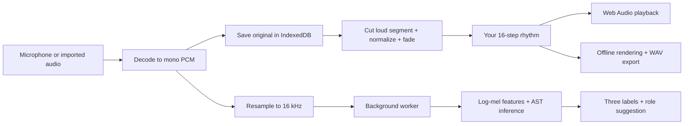

# Understand Dirt DJ

## Your 30-second explanation

“Dirt DJ gets people outside to collect sounds instead of staring at their screens. Sound Detective gives me a mystery clue. I find a sound outdoors and capture three seconds; an open-weight model checks it on the device. AI matches and my own confirmations are tracked separately. I can also record footsteps, leaves, or birds to make music. My sampler cuts those recordings into playable sounds, and I arrange them on a rhythm grid. The app and model are cached locally, so after setup it works without internet and recordings never have to leave my device.”

## First, separate the two jobs

**Recognition:** What does this recording sound like? AST produces labels and scores.

**Music:** When should this sound play, and how loudly? The sampler, your grid, and Web Audio answer that. AI does not invent audio, write the rhythm, or secretly call an API.

## What is an audio waveform?

A microphone measures changes in air pressure. Digital audio stores measurements as numbers called **samples**. A sample rate of 44,100 Hz means 44,100 measurements per second. In the app, PCM is a `Float32Array` containing those measurements, usually between -1 and 1.

“Sample” can mean both one measurement and a short sound used in music. In `types.ts`, `Sample` means the whole recording with its waveform, name, rate and predictions.

**Mono** has one channel. Imported stereo channels are averaged together because the model expects one channel and the sampler is mono. **Resampling** changes the measurement rate while keeping the approximate duration. AST expects 16,000 Hz; exported music uses 44,100 Hz. The MVP uses linear interpolation for resampling. A production audio tool could use a higher quality band-limited resampler.

## What exactly does the AI do?

The **Audio Spectrogram Transformer**, or AST, is a pretrained sound classifier. We use a model fine-tuned on AudioSet's 527 categories: sounds such as footsteps, wind, speech, and bird vocalizations.

It does not listen like a person. Transformers.js converts audio into a **log-mel spectrogram**: a representation of how frequency energy changes over time. AST processes patches of those features using attention and returns scores for sound categories. We show the three highest scores.

The model was already trained. Dirt DJ runs **inference**, which means applying learned weights to new audio. We are not training or fine-tuning the model in this app.

The downloaded ONNX checkpoint uses **8-bit quantization**. Quantization stores weights more compactly than full precision, reducing download size and generally lowering runtime memory needs. This can affect accuracy. The file is still about 91 MB, and working memory is larger than file size.

**ONNX** is a model exchange format. **ONNX Runtime** executes that format. **WebAssembly** lets the browser run the runtime's compiled numerical code locally. **Transformers.js** ties the preprocessing, model loading and inference together. These three names describe different layers, not three separate AIs.

Model scores are not proof. Wind, distance, overlapping noises, or short recordings can confuse the classifier. “Bird” is a broad event category, not a species identification. You can use a sound in any musical lane regardless of its label.

## Why a Web Worker?

The page's main JavaScript thread handles clicks and rendering. Running a large model there can freeze the interface. A worker is a separate background execution context.

`src/ai/client.ts` sends a resampled waveform to `src/ai/worker.ts`. The worker loads the model once and sends predictions back. The recording itself stays in the browser. Request IDs connect each response to the recording that requested it. Errors/timeouts are reported without deleting the sound.

The runtime uses one WASM thread. The worker already keeps inference off the UI thread, and a single WASM thread avoids needing special cross-origin isolation headers.

## How do recordings become drums?

1. `cutSample()` looks for the loudest 25 ms region in the recording.
2. It starts a little before that region so the sound's attack is preserved.
3. It takes a short slice: 0.24 s for thump, 0.30 s for crunch, 0.14 s for rustle, or 0.65 s for call.
4. It normalizes the slice gently, limiting the gain boost to 3×. Silent recordings are not amplified without limit.
5. It fades the slice's first and last few milliseconds to reduce clicks.

This is a practical MVP heuristic. It does not separate a bird from traffic or isolate different sources from one recording. Clear, close recordings make better samples. The original waveform is retained, so using the same sound in a different lane creates a fresh cut.

Label-to-role suggestions are plain regex rules. “Footsteps” suggests thump; “bird” suggests call; “wind” suggests rustle. The model scores influence which labels are considered, but the mapping itself is not a trained model.

## Explain the rhythm grid

The grid has **16 steps**, representing one bar of four beats, subdivided into sixteenths. At 120 BPM, one beat lasts 0.5 seconds and one step lasts 0.125 seconds.

`seconds per step = 60 ÷ BPM ÷ 4`

An enabled square schedules a sample at that point. Swing delays alternating steps slightly. Volume scales each lane's level; mute skips its events. “New groove” chooses one of three hand-written patterns. It is not generative AI.

The audio engine schedules sounds on Web Audio's clock, rather than JavaScript timers. The transport keeps the current bar unchanged and queues grid, sample, level, mute, swing, and BPM edits for the next bar. It schedules sample nodes ahead of their start times, with a short JavaScript timer maintaining the queue. Editing a queued future bar replaces only that bar’s nodes; the current bar keeps playing. The visual playhead reads the transport’s current bar and uses animation frames only to display progress. A compressor reduces sharp peaks when samples overlap.

`OfflineAudioContext` renders the same event schedule into an audio buffer without playing it through speakers. “Offline” here means rendering without real-time playback, and is separate from internet connectivity. The WAV encoder adds a valid RIFF/WAVE header and converts the rendered waveform to 16-bit PCM.

## What saves what?

| Storage | Contains | Why this choice |
| --- | --- | --- |
| IndexedDB | Original PCM recordings, names, AI predictions, current tempo/grid/levels | Supports structured data and typed arrays without a server |
| Cache API | App HTML/JS/CSS, model/config files, local WASM runtime | Keeps request/response files available without network |
| Service worker | Fetch-handling code; not the recording database | Intercepts requests and returns cached files when disconnected |

The first `npm run setup` downloads model files from a pinned upstream revision. It checks the model's SHA-256 fingerprint. The browser's **Prepare offline** action then saves these locally served files on that particular device. Both steps matter: having a model on the developer's laptop does not automatically install it on a user's phone.

`env.allowRemoteModels = false` prevents the inference pipeline from falling back to Hugging Face. The WASM paths are also local, preventing a hidden runtime CDN dependency. The service worker precaches the app shell; the large AI pack is cached separately after you choose to prepare it.

Clearing site data deletes recordings and caches. Different devices do not sync. There is no account or server database. A localhost preview needs its local server running; an HTTPS installation can use its cached app shell after setup.

## Read the code in this order

1. **`src/types.ts`** — Defines what a sample, track, and project contain.
2. **`src/App.tsx`** — Connects buttons and state to the recording, AI, storage, and music modules.
3. **`src/Recorder.tsx`** — Permission, microphone capture, level meter, six-second limit, and track cleanup.
4. **`src/audio/dsp.ts`** — Resampling, sample cuts, role rules, rhythm timing, waveform display, WAV encoding.
5. **`src/audio/engine.ts`** — Real Web Audio decoding, playback and offline rendering.
6. **`src/ai/client.ts` and `src/ai/worker.ts`** — Background inference and local-only model configuration.
7. **`src/storage/db.ts`** — IndexedDB reads and writes.
8. **`src/offline.ts`** — AI-pack caching, progress, and readiness checks.
9. **`scripts/setup-offline.mjs`** — Reproducible model download and local WASM copy.
10. **`scripts/build-offline.mjs`** — Builds a versioned offline app shell and service worker.

`src/audio/demo.ts` generates synthetic test fixtures with sine waves and seeded noise. These fixtures are used by automated tests; the app has no demo button. This is ordinary synthesis, not AI and not outdoor recordings. This document provides the code explanation outside the app. `src/styles.css` defines the responsive design, without external fonts or images.

## Why these technologies?

- **React:** Makes it straightforward to keep the grid, sample cards and playback state in sync.
- **TypeScript:** Catches mismatched data structures before the app runs and documents each module's inputs/outputs.
- **Vite:** Provides fast local editing and builds files any static HTTPS host can serve.
- **Browser audio APIs:** Record and manipulate real sound without uploading it or requiring a native app build.
- **An open-weight classifier:** Makes local inference possible and lets us replace the recognition layer later.
- **A PWA:** One browser app works on laptops and compatible phones, with a cached shell and home-screen installation where supported.

There is no Python AI server, LLM, agent framework, paid API, or cloud database. Those are unnecessary for this version.

## The mobile app

**Capacitor** packages the shared React code into Android and iOS apps. Native builds include the local model. Filesystem and Share plugins handle WAV export; Local Notifications handles optional search cues. No app backend or multiplayer hub is required.

The Android debug build compiles here. Physical-phone testing and the iOS build remain unverified because full Xcode is unavailable. See [MOBILE.md](MOBILE.md) for installation steps.

## Questions someone might ask you

**“Where is AI essential?”**
It interprets new recordings from arbitrary environments and judges Sound Detective evidence against the clue’s sound family. Handwritten rules alone could sequence a sound, but could not provide the same broad learned sound recognition. The recognition layer connects an unfamiliar recording to labels and musical-role suggestions.

**“Could a cloud model do this?”**
Yes, but a cloud-dependent classifier would require a connection and sending recordings to a server. This local approach supports disconnected use and user-controlled audio while avoiding per-request inference charges.

**“Does it cost nothing?”**
There are no inference API charges. Devices still use CPU, battery, memory and storage; hosting can cost money. The first download requires internet.

**“Why AST, not YAMNet?”**
YAMNet was considered during brainstorming. The shipped implementation uses AST because its ONNX conversion works with the selected Transformers.js audio-classification pipeline. Do not say both models are running.

**“How will you prove it is offline?”**
Prepare the offline pack, disconnect, reload the page, import a new sound, and show that new AI labels appear. Then play/export a beat. The browser test exercises this flow without mocking the model.

**“What are the current limits?”**
This is an MVP with heuristic sample trimming, broad sound labels, one saved project, mono output, and manual rhythm editing. Mobile performance depends on hardware/browser memory. It does not generate melodies, separate audio sources, upload sound, or provide social accounts. The screen is needed for collecting and mixing; between short recordings, the activity is outdoors.

## How Sound Detective works

`src/detective.ts` is the game rule layer. It defines eight curated riddles tied to actual AudioSet labels: crackling/rustling, footsteps, birds, water, clapping, whistling, knocking and humming. A seeded shuffle picks four distinct clues. Swapping an unavailable clue selects a different sound family without awarding a discovery. No LLM generates these clues.

`src/SoundDetective.tsx` displays one clue, an optional hint, the AI verdict and a casebook. Hear/read the clue, then lock the phone to search. The microphone is off while exploring. The optional native approximately 90-second reminder uses the existing Local Notifications plugin; browser reminders are foreground chimes only.

`src/Recorder.tsx` starts detective capture after one tap and stops at three seconds. Manual field-kit captures remain six seconds. `src/App.tsx` saves detective evidence in IndexedDB without assigning a musical lane, sends it to AST, and stores the resulting predictions. The saved recording remains available if inference fails. Speech, sample preview and loop playback stop before recording.

**The AI decision:** `judgeSound()` takes AST’s three highest scoring categories and compares them with an explicit label allowlist for the clue. To count as a match, a target label must score at least 0.12 and be no more than 0.08 below the highest score. These are conservative gameplay thresholds, not calibrated probabilities. Exact label matching avoids accepting a train whistle as a person whistling, or mains hum as a person humming. Some clues allow related sound families, such as rustling leaves for crackling evidence.

A match automatically earns a discovery. An uncertain or unavailable check earns nothing automatically. The player can retry, request another clue or explicitly keep their own find. A self-confirmed discovery has `verified: false`; the casebook shows **Confirmed by you** and excludes it from the AI-match count. The model is a fallible helper, not proof that a real-world answer is correct. Four discoveries close the case. There is no generated groove reward.

Case state lives in `localStorage` under `dirtdj-detective-v1`; audio and labels live in IndexedDB. Pending evidence survives reload and uses its saved predictions. Missing predictions offer Check again. Deleting evidence reopens its clue. Starting another case retains earlier audio. The old adventure progress is not converted into AI matches; its recordings remain untouched.

`src/voice.ts` selects only an installed English voice with `localService: true`. It never selects a remote voice. Device/browser availability varies; the clue is always available as text. Narration is canceled before recording or when pocket view closes. Speech synthesis is separate from the AST model.

The native Android/iOS wrappers bundle the model, WASM runtime, clues and UI. The browser caches them during Prepare offline. A cloud classifier would require connectivity and uploading evidence; this open-weight approach checks a newly recorded sound without either, with no per-inference API bill. The prerecorded clues and ordinary game rules remain editable independently of the model.

## Explaining it in one sentence

“Dirt DJ’s Sound Detective is an offline outdoor scavenger hunt: I follow sound clues, an open-weight model checks my finds on my device, and I build a casebook while spending most of the game away from the screen.”
